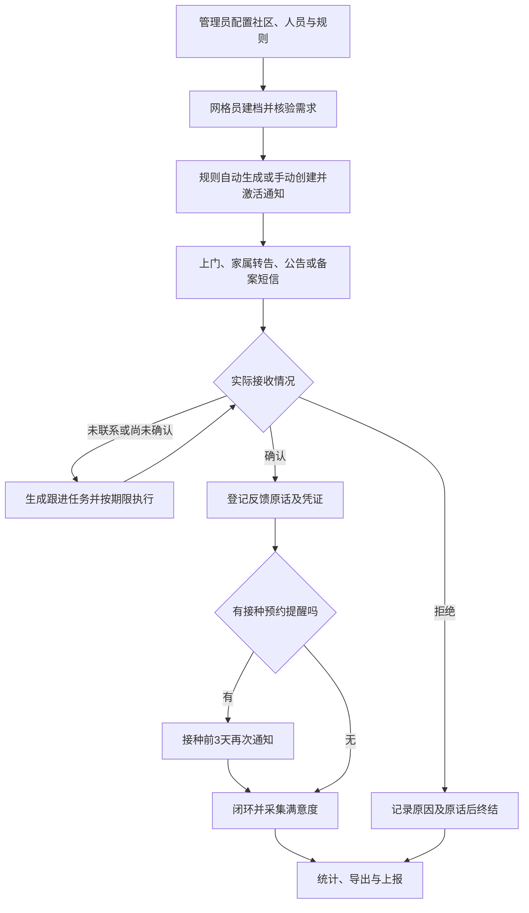

本次工作界面已调整，入口和每日步骤请先看[11.21工作界面使用说明](11.21工作界面使用说明.md)。

# 功能核对与管理员操作流程（v1.6.0）

更新方法见[11.20启动更新](11.20启动更新.md)。本次使用独立测试库验证；当前业务库按说明升级后生效。

隐私沿用此前确认的调整：姓名、电话、住址及家属资料在专用字段中加密存储，管理员和当前负责网格员可按权限查看；身份证号禁止录入。统计员只看汇总，报表不包含个人明细；备注和政策问答不承载原始联系资料。

## 功能核对

| 文档要求 | 本版实现与入口 |
| --- | --- |
| 自动编号、字段和格式校验 | 老人档案自动生成SH-L-YYYY-XXX，跨社区统一序列、防重号；维护性别、出生年月、登记人、负责人、需求和备注，自动记录更新时间。出生年月显示为“YYYY年MM月”，接口使用YYYY-MM，不接受未来年月。 |
| 查询筛选 | 编号、姓名、本人电话精确查询；出生年月起止、出生月份、接种状态、服务需求筛选。起止选同一年月即精确查询，出生月份用于生日关怀。 |
| 更新与接种核验 | 编辑、负责人移交、资格/预约/日期/针次核验均有权限、事务、版本和日志控制。卫生服务中心的真实数据接口为可选项，目前未连接，使用人工核验，不伪造同步成功。 |
| 自动通知 | 启用规则后自动生成生日月份关怀及符合条件、未接种的疫苗提醒，按规则、月份、老人去重。管理员可立即按当前社区各网格员范围排队生成。 |
| 通知主题 | 生日、疫苗、健康讲座、其他政务通知均可手动创建；前两类支持规则生成。 |
| 上门告知 | 确认接收必须上传经过人工脱敏的签字确认图片；上门无人时不能伪造签字。 |
| 家属转告 | 必填实际转告家属姓名和关系，姓名加密保存；确认接收须明确已转告。 |
| 公告张贴 | 必须上传照片，只记已张贴，不等于本人接收；自动安排后续确认。 |
| 短信通知 | 管理员配置HTTPS网关、密钥、备案签名和模板；只发送至档案中已备案且获授权的家属手机，平台受理后安排确认任务。当前没有平台账号，未发送真实短信。 |
| 接收跟踪 | 确认、未联系上（上门无人/电话无人接/其他）、拒绝分别记录。其他或拒绝必须说明原因，确认或拒绝必须客观记录反馈原话。保留触达、凭证和反馈更正历史。 |
| 跟进任务 | 未联系上自动生成再次联系任务，默认次日到期；预约前3天再次提醒，无预约先核实。任务显示老人编号、姓名、经办人和期限。 |
| 跟进闭环 | 必填执行结果；需重试则指定未来期限；确认或拒绝同步触达记录，更新通知状态。达到重试上限后说明终结原因，不无限重试。 |
| 自动统计 | 每日01:30检查并补生成统计员上月Excel报表，同一人同一月份不重复，月初停机后也可补生成。后端需持续运行且启用调度。 |
| 统计筛选和内容 | 按社区、经办人、通知类型、疫苗周期、月份或日期范围统计。包括覆盖率、满意度、接种率、渠道使用率、闭环率、按期跟进率、各接种状态人数和服务缺口分析。 |
| 导出上报 | Excel和Word异步导出，保留范围、快照及分子分母；Excel另有服务缺口分析工作表。历史任务保留，生成文件有效期7天。 |

## 管理员配置与操作

1. **社区和人员**：用admin登录，“社区管理”核对四社区资料与网格；“用户管理”分配网格员的社区范围。同社区可以有多个网格员，但每名老人必须有明确负责人。
2. **老人建档监督**：网格员在自己的“老人档案”登记或编辑资料，管理员查看完整性并管理老人归属；要自动生日关怀，网格员需勾选“生日关怀”服务需求。
3. **接种核验监督**：由负责网格员核实资格、状态、预约和实际针次。未知保持待核实，不把通知或预约当成已接种，管理员仅查看核验结果。
4. **启用规则**：“自动规则配置”启用生日或疫苗规则；疫苗规则选择对应周期。可以等系统扫描，也可点“立即安排联系名单”，选择月份后排队，再刷新作业状态。
5. **工作监督**：首页按网格员查看闭环率、未完成联系、未联系上和逾期。点击“联系进度”查看明细；临时讲座、政务通知由负责网格员新建和发布。
6. **跟进监督**：“跟进进度”通过业务、状态、负责人、跟进类型和截止范围下拉框筛选并查看历史；由网格员在“服务跟进”记录实际结果、下次期限或终结原因。
7. **反馈与上报**：网格员在联系记录中采集满意度；管理员和统计员从“统计报表”查询、导出Excel/Word。管理员不代办联系、跟进、短信、满意度等业务，后端同样禁止写入。
8. **追溯复核**：“操作日志”查看操作人、时间、社区和结果；发现指标异常先核对业务记录，不直接改统计数字。

首页“生日月份关怀”显示所选月份的姓名、内部编号、社区、负责人及是否登记生日关怀需求。管理员跨社区查看，网格员只看本人名单。只有出生年月，因此按月份组织关怀，不能判断生日具体哪一天。

初始规则默认关闭。启用后每小时第10分钟扫描本月及提前准备窗口涉及的下一月份；提前天数用于跨月准备，不是按生日具体日期提前。立即生成只处理当前社区，其他社区需切换后配置。作业COMPLETED表示处理完成；没有符合条件的老人时不会新增通知。

## 整个业务过程



**生日例子**：核对本月名单→启用生日规则或立即生成→网格员实际联系→上门确认上传签字图片，家属转告登记姓名和确认→未联系则按跟进期限再次联系→记录结果及满意度→统计上报。

**疫苗例子**：核验资格和未接种状态→生成提醒→核实预约→预约前3天再次通知→实际接种后核验日期和针次。第一次通知确认后，尚有接种前提醒时仍保持跟进；最终提醒完成后闭环。实际接种由接种记录决定，不由通知状态决定。

公告张贴和短信平台受理均不会自动计为“已确认接收”；后续需要通过实际联系确认。再次跟进仍未联系上时，可以指定新的未来期限；明确拒绝应尊重本人意愿，不为改善指标改写成成功。

## 短信接入和发送

1. 取得备案短信平台的账号、签名及模板，并准备兼容下方约定的HTTPS网关。供应商原生API格式不同的，需平台或适配网关转换，不能保证填入任意供应商地址即可发送。
2. 管理员切换社区→“短信平台设置”，填写地址、密钥、签名和模板并启用。密钥加密保存、不回显；留空保存保留原密钥。地址不允许本机、私有网络、URL凭据或查询串。
3. 老人档案填写家属手机号，并确认“家属手机号已备案，并已获短信服务通知授权”。初始合成号码默认未授权，不可直接用于真实发送。
4. 通知管理对未终结对象点“发送短信”，确认后排队；“记录”中查看作业。号码、授权、归属或通知状态变化后重新核验，不把已排队号码当成永久授权。
5. PENDING/PROCESSING表示处理中，COMPLETED表示平台受理，FAILED表示未完成。随后实际联系并登记接收结果，才计入确认接收人数。

网关接收POST JSON，认证和幂等请求头如下。重试使用同一请求号，网关必须按Idempotency-Key去重：

```http
Authorization: Bearer <后台保存的网关密钥>
Idempotency-Key: community-sms-<作业编号>
```

```json
{
  "requestId": "community-sms-<作业编号>",
  "to": "<档案中已备案且获授权的家属手机号>",
  "signature": "<备案签名>",
  "templateId": "<备案模板编号>",
  "parameters": {
    "noticeTitle": "<通知主题>",
    "noticeContent": "<通知内容>",
    "elderNo": "<老人内部编号>"
  }
}
```

成功受理须返回HTTP 2xx及`{"accepted":true,"messageId":"provider-message-001"}`。messageId为1至100个英文、数字、下划线、点、冒号或连字符。只返回HTTP成功、缺少消息号或accepted不是布尔值true，均不登记发送成功。使用合法TLS证书，不关闭证书校验；接收手机号不写入作业载荷和日志。

## 报表口径

- **通知覆盖率**：已确认接收的通知对象数÷有效通知对象数；每位老人、每批通知的接收对象单独计数，排除取消对象。
- **满意度**：满意反馈数÷有效反馈数；同一对象取截止时点最新有效反馈，更正留历史，无样本不报0%。
- **接种率**：具体疫苗周期内，已完成接种且符合条件人数÷符合条件人数；资格未知不进分母，各周期分别计算。
- **状态人数与缺口**：展示未接种、部分完成、已完成、状态待核实及资格待核实人数，量化待联系、未联系上、拒绝和符合条件尚未完成接种记录。登记状态不能用于自动推断医学原因，具体原因需核实原话和接种记录。
- **筛选与快照**：导出使用与页面相同的社区、经办人、类型、周期和日期范围；历史归属、事件和接种事实按截止时点计算，文件不夹带老人姓名、电话或住址。

本版已在独立数据库验证业务回归、短信模拟网关受理/拒绝、授权与号码变化、发送去重、两个报表格式及初始数据重复安装和回滚。真实卫生服务中心对接及真实短信发送仍依赖外部平台资料和授权。
